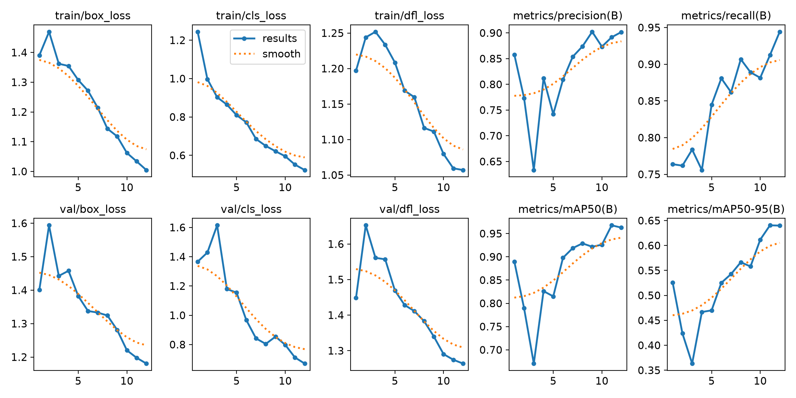
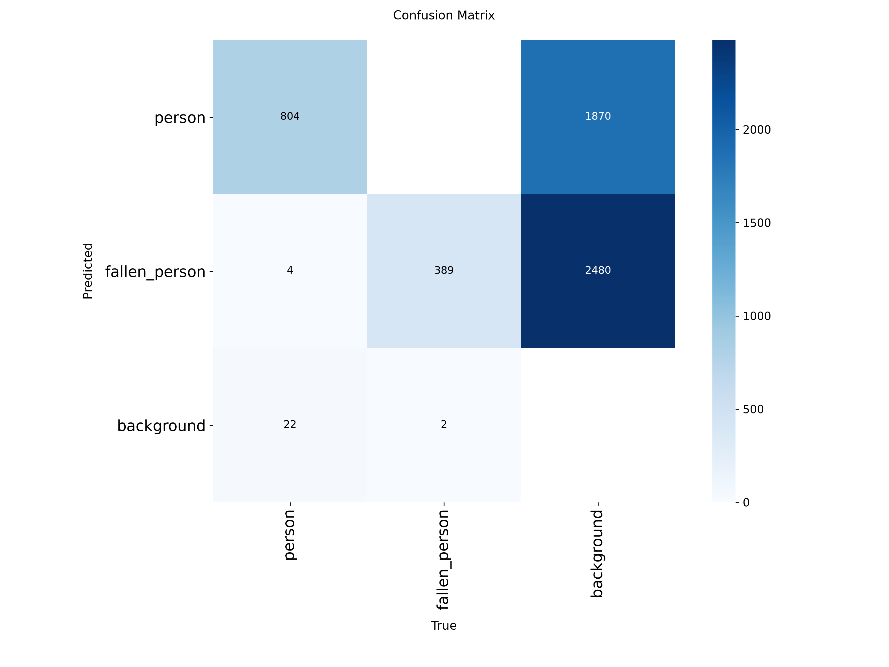
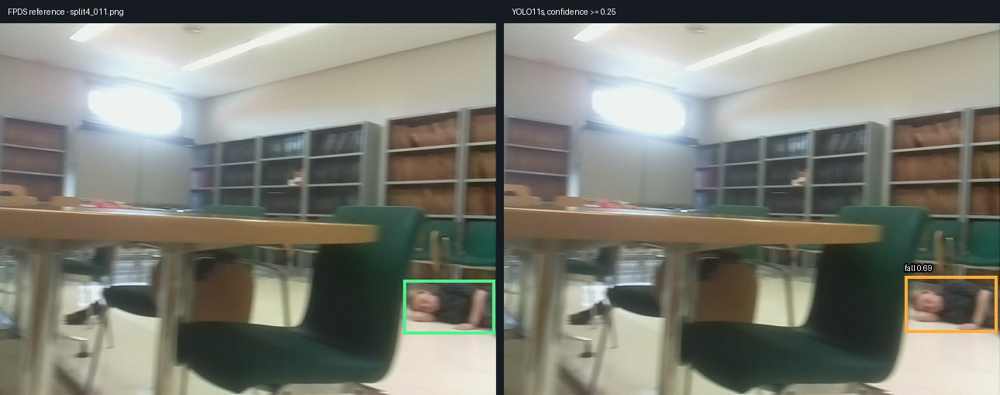
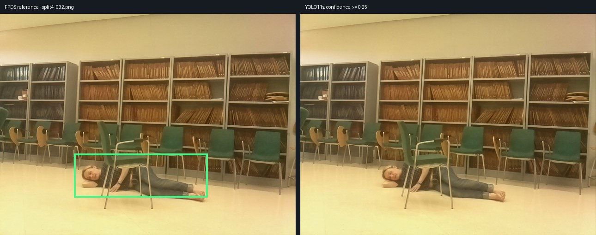
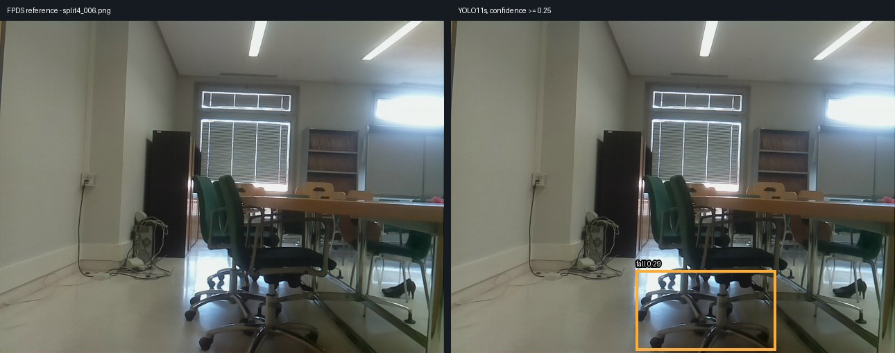

# Детекция упавших людей на изображениях с камер видеонаблюдения

## Задача

Разработать прототип, который принимает один кадр и отмечает рамками упавших людей. Решение выполнено на уровне дообучения готовой сети. Использована YOLO11s с предобученными весами Ultralytics. Размер модели подходит для запуска на процессоре, который использовался в эксперименте. [Описание YOLO11](https://docs.ultralytics.com/models/yolo11/)

## Данные

Используется архив FPDS v1 из работы Maldonado-Bascón и соавторов, *Fallen People Detection Capabilities Using Assistive Robot* (2019). В архиве 2 062 кадра PNG с разрешением 640 × 480 и текстовая разметка. Авторы снимали постановочные ситуации в восьми разных помещениях и на открытых площадках камерой на роботе, на высоте 76 см. Каждый `split` соответствует отдельной сцене. [Статья авторов](https://gram.web.uah.es/data/publications/electronics19-maldonado.pdf) · [Страница набора](https://gram.web.uah.es/data/datasets/fpds/index.html)

| Выборка | Группы FPDS | Кадры | Люди без падения | Упавшие люди | Пустые кадры |
| --- | --- | ---: | ---: | ---: | ---: |
| Обучение | `split1`, `split2` | 723 | 257 | 501 | 38 |
| Валидация | `split3` | 366 | 175 | 180 | 16 |
| Тест | `split4`–`split8` | 973 | 830 | 391 | 14 |

Числа для классов — количество размеченных рамок. В одном кадре может быть несколько людей. Тестовые сцены взяты из исходного протокола FPDS. `split3` выделен из исходной обучающей части целиком, чтобы выбор лучшей эпохи проходил на отдельной сцене. Код подготовки проверяет совпадение пикселей между выборками по SHA-256. На использованном архиве совпадений между выборками не было.

FPDS хранит класс `-1` для человека без падения и `1` для упавшего, а рамку — в виде левой, правой, верхней и нижней границ в пикселях. `prepare_data.py` переводит классы в `0` и `1`, а рамку — в центр, ширину и высоту в долях от размера изображения. Пустые кадры остаются в наборе. [Формат разметки YOLO](https://docs.ultralytics.com/datasets/detect/)

## Метод и эксперимент

YOLO11s предсказывает рамки и классы. Сеть дообучалась 12 эпох на CPU, по 8 кадров в пакете, с размером входа 320 × 320 и `seed=42`. Первые 10 слоёв были заморожены. Ultralytics выбрал оптимизатор AdamW с базовым шагом 0,001667. Конфигурация запуска сохранена в `training/args.yaml` в MLflow.

Основная метрика для выбора весов — **mAP50–95 на валидации**. Она учитывает, нашла ли модель нужный класс и насколько точно поставила рамку, при порогах совпадения от 0,50 до 0,95. Дополнительно измеряются AP50, точность и полнота. AP50 для класса `fallen_person` отдельно показывает, как модель находит упавших людей. Тестовые сцены используются для финальной оценки выбранных весов.

Компоненты Ultralytics отвечают за архитектуру YOLO11s, загрузку исходных весов, обучение и расчёт метрик. В проекте реализованы подготовка разметки и разбиение, запуск обучения с записью в MLflow, HTTP API и запуск компонентов через Docker Compose. [Ultralytics](https://github.com/ultralytics/ultralytics) · [MLflow](https://mlflow.org/docs/latest/tracking/server/) · [FastAPI](https://fastapi.tiangolo.com/tutorial/request-files/)

## Результаты

У финального запуска в Docker лучшая эпоха — 11, с mAP50–95 на валидации 0,64046. На графиках видны составляющие функции потерь для обучения и валидации и метрики качества на валидации. [Запуск в MLflow](http://localhost:5000/#/experiments/1/runs/5ea928d9a3e64a0fa66c7ff8be312fcd)

Веса этой эпохи проверены на 973 кадрах из пяти тестовых сцен.

| Класс | Precision | Recall | AP50 | AP50–95 |
| --- | ---: | ---: | ---: | ---: |
| Человек без падения | 0,932 | 0,812 | 0,912 | 0,513 |
| Упавший человек | 0,920 | 0,913 | 0,948 | 0,488 |
| Среднее по классам | 0,926 | 0,862 | 0,930 | 0,500 |

AP50 для упавших людей высокий, а AP50–95 заметно ниже. Рамки часто пересекаются с разметкой хотя бы наполовину, но при более строгих требованиях к совпадению качество падает.

До настройки Docker Compose был предварительный запуск на Windows с тем же разбиением и основными параметрами. Его история перенесена в MLflow из исходного CSV и журнала. В сервисе используются веса финального запуска в Docker. [Предварительный запуск](http://localhost:5000/#/experiments/1/runs/433ffa753d2e42afa3a6b8e85e6b4bc4)

## Примеры и анализ ошибок

Для разбора использовались те же 973 кадра и порог сервиса 0,25. Предсказания сопоставлялись с рамками класса `fallen_person` по убыванию уверенности. Рамка считалась правильной при IoU ≥ 0,50. IoU — отношение площади пересечения двух рамок к площади их объединения. Каждая размеченная рамка могла быть сопоставлена только одному предсказанию.

Получилось **358 совпавших, 48 лишних и 33 пропущенных рамки**. На иллюстрациях разметка FPDS показана зелёным слева, предсказание YOLO11s — оранжевым справа.

**Удачное предсказание, `split4_011.png`.** Модель нашла человека у правого края кадра с уверенностью 0,69. Предсказанная рамка близка к размеченной.

**Пропуск, `split4_032.png`.** Стул закрывает часть тела лежащего человека. При пороге 0,25 модель не вернула рамку.

**Ложное срабатывание, `split4_006.png`.** На кадре без людей модель выделила основание кресла и присвоила ему класс `fallen_person` с уверенностью 0,29.

## Выводы и ограничения

Прототип обнаруживает упавших людей на отдельных кадрах FPDS и возвращает рамки через HTTP API. Порог уверенности влияет на число сигналов. На приведённом кадре с креслом порог 0,30 убрал бы ложное срабатывание. Подбирать порог для будущей версии следует по валидации, где можно посчитать, сколько настоящих падений при этом будет пропущено.

Один кадр позволяет судить о положении тела. Для анализа самого движения падения нужна последовательность кадров. FPDS v1 снят с низкой точки, поэтому для применения на высоко установленных камерах нужна отдельная проверка на кадрах с такого ракурса. [Описание съёмки FPDS](https://gram.web.uah.es/data/publications/electronics19-maldonado.pdf)

Воспроизводимый запуск обучения, тестирования через API и просмотра эксперимента описан в [README](README.md).
